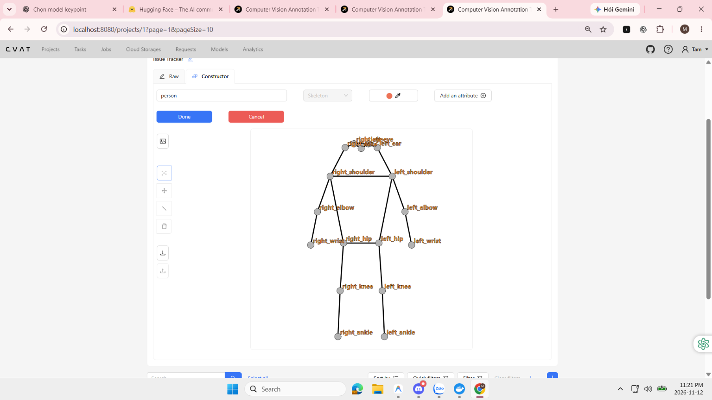
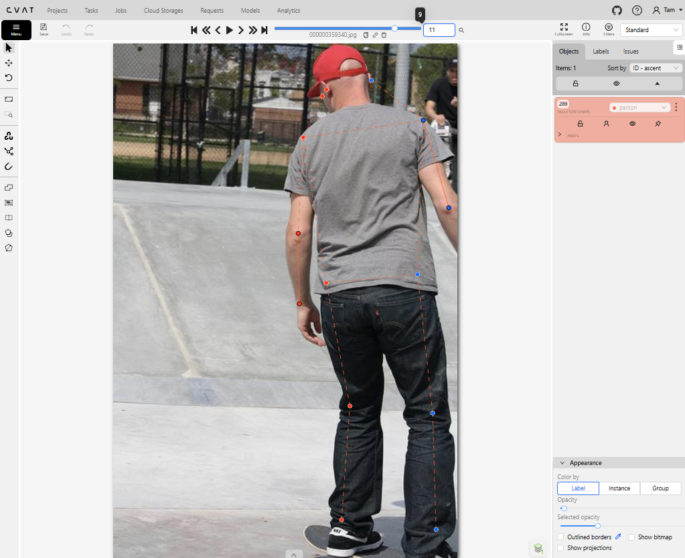
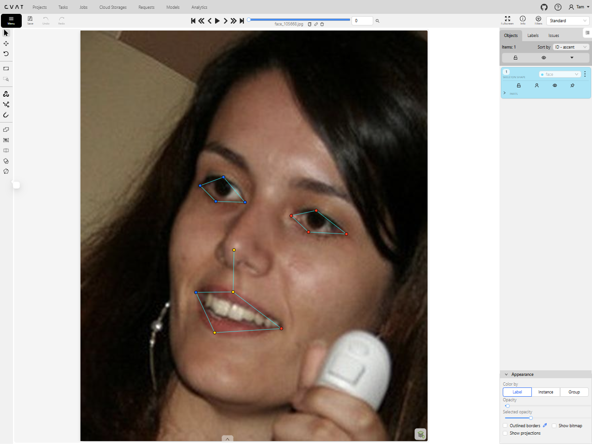
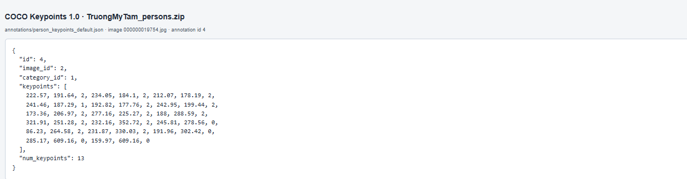

# Báo cáo cá nhân — TruongMyTam-03106

Dữ liệu: 12 ảnh người COCO val2017 (Lin et al., 2014) và 8 ảnh chân dung Wikimedia Commons, chỉ dùng trong lớp.

## 0. Thông tin học viên

- Họ tên: Trương Mỹ Tâm
- MSSV: 03106
- Email: 26ai.tamtm2@vinuni.edu.vn
- Link repository: [GitHub](https://github.com/tam8738/K5-L2-DAY04-TruongMyTam-03106-KeypointPose)
- Phiên bản CVAT (Help → About): 2.74.1
- Máy: hệ điều hành Windows · RAM 11.5 GB · chạy CVAT chế độ đầy đủ
- Bộ ảnh (`src/exports/assignment.json` do `lab.py setup` tạo): có
- Giờ bắt đầu: 20h16
- Giờ kết thúc: 23h30

## 1. Kiểm tra label (CP0)

| Label | Kiểu | Số điểm | Tên điểm đúng bảng của lab? | Đúng thứ tự? | Số cạnh |
|---|---|---:|---|---|---:|
| `person` | Skeleton | 17 | Có | Có | 19 |
| `face` | Skeleton | 13 | Có | Có | 13 |

Mẫu `person` dựng theo người quay mặt về camera (các điểm `left_*` nằm bên phải khung mẫu)? Có

Cách đổi cờ `occluded` / `outside` cho **một điểm** trên phiên bản CVAT này (một câu):

Click chọn điểm cần đổi cờ trên skeleton, sau đó trong bảng thuộc tính bên phải bật/tắt checkbox `occluded` (hoặc `outside`) cho riêng điểm đó — chỉ điểm được chọn thay đổi, các điểm còn lại giữ nguyên.

## 2. Số lượng đã gán và thời gian (CP1, CP2)

| Nhóm ảnh | Số ảnh | Số skeleton đã gán | Số người dưới 60 px (không gán) | Số poster / gương / màn hình bỏ qua | Thời gian (phút) |
|---|---:|---:|---:|---:|---:|
| `easy` | 5 | 5 | 0 | 0 | ~25 (ước lượng) |
| `occluded` | 3 | 6 | 0 | 0 | ~21 (ước lượng) |
| `back` | 2 | 3 | 0 | 0 | ~16 (ước lượng) |
| `small` | 1 | 3 | 0 | 0 | ~8 (ước lượng) |
| `crowd` | 1 | 4 | 0 | 0 | ~14 (ước lượng) |
| `faces` | 8 | 8 | — | 0 | ~30 (ước lượng) |

- Số ảnh người đã xong ở mốc phút 105: ~10 / 10
- Thời gian ước lượng (phút): CP1 ~84 · CP2 ~30 · CP3 ~20. Tổng thời gian buổi làm theo giờ bắt đầu/kết thúc đã ghi: khoảng 194 phút (20:16–23:30).
- Ảnh tốn thời gian nhất là ảnh nào, vì sao?

Ảnh `000000012552.jpg` (crowd) là ảnh khó nhất trong các trường hợp đã ghi nhận: có ba skeleton và cần kiểm tra kỹ việc gán trái/phải ở tư thế tay bắt chéo. Thời gian riêng cho ảnh này ước lượng khoảng 14 phút theo nhịp hướng dẫn cho nhóm `crowd`.

## 3. Bảng ca khó (CP1, CP2)

Mỗi điểm bạn phân vân một dòng, nhất là phân vân giữa `v = 1` và `v = 0`, hoặc không chắc hướng người.

| Ảnh | Người / mặt | Điểm | Cờ đã chọn | Phân vân giữa | Lý do chọn |
|---|---|---|---:|---|---|
| 000000012552.jpg | Người #1 | nose, left_eye, right_eye | 0 | v=1 và v=0 | Người quay lưng, không thấy mặt và không đoán chắc vị trí mũi, mắt nên chọn v=0 |
| 000000461389.jpg | Người #2 | right_shoulder | 1 | v=1 và v=0 | Vai phải bị che một phần nhưng vẫn ước lượng được vị trí dựa vào phần thân trên còn thấy, tuy nằm sát mép ảnh |
| 000000019754.jpg | Người #1 | right_hip | 1 | v=1 và v=0 | Hông phải bị che bởi vật nhưng ước lượng chắc chắn dựa vào vai phải và gối phải |
| 000000461389.jpg | Người #2 | right_knee | 0 | v=0 và v=1 | Chân phải bị che hoàn toàn bởi vật phía trước, không đoán chắc chắn vị trí gối |

## 4. Bảng tự review (CP3)

Đi từ ảnh cuối về ảnh đầu. 5 ảnh người (ít nhất 2 ảnh `back` hoặc `crowd`) và 3 ảnh mặt. Ít nhất 8 dòng, kể cả dòng `ok`. Ghi lỗi trước, sửa sau.

Mã lỗi dùng đúng một trong: `lr_swap`, `vis_flag`, `position`, `missing`, `extra`, `ok`.

| Ảnh | Người / mặt | Điểm | Mã lỗi | Ghi chú | Đã sửa? |
|---|---|---|---|---|---|
| 000000012552.jpg | Người #2 | left_shoulder, right_shoulder | lr_swap | Script cảnh báo cặp shoulder nằm ngược phía so với các cặp còn lại. Kiểm tra lại và xác nhận thực tế đúng vì tay bắt chéo thật | Không cần sửa — tư thế bắt chéo thật |
| 000000461389.jpg | Người #2 | right_shoulder | vis_flag | Script cảnh báo right_shoulder v=1 nằm sát mép ảnh (189, 1). Kiểm lại: khớp vai vẫn nằm trong ảnh, chỉ bị che nên giữ v=1 | Không sửa — giữ v=1 vì ước lượng chắc |
| 000000297227.jpg | Người #1 | — | ok | Đã kiểm tra hướng người, trái/phải, cờ, đường nối: không có lỗi | — |
| 000000359340.jpg | Người #1 | — | ok | Đường nối không bắt chéo, cờ đúng theo bốn câu hỏi | — |
| 000000269462.jpg | Người #1 | — | ok | Kiểm trái/phải đúng hướng, cờ visibility hợp lý | — |
| face_122747.jpg | Mặt #1 | — | ok | Mắt trái/phải đúng theo người, mí mắt đặt đúng mép, khóe miệng đúng vị trí | — |
| face_219250.jpg | Mặt #1 | — | ok | Kính râm: 4 điểm mắt đã đặt occluded, vị trí theo gọng kính | — |
| face_264124.jpg | Mặt #1 | — | ok | Mặt nghiêng: điểm bị che bởi sống mũi đã đặt occluded đúng quy tắc | — |

Tổng hợp số lỗi theo mã:

| `lr_swap` | `vis_flag` | `position` | `missing` | `extra` | `ok` |
|---:|---:|---:|---:|---:|---:|
| 0 | 0 | 0 | 0 | 0 | 6 |

> Ghi chú: 2 cảnh báo từ script đã kiểm tra lại — 1 cảnh báo lr_swap ở 000000012552.jpg thực tế là tư thế bắt chéo thật (không phải lỗi), 1 cảnh báo vis_flag ở 000000461389.jpg giữ nguyên v=1 vì khớp vai vẫn ước lượng được.

Điểm còn phân vân giữa `v = 1` và `v = 0` (ghi cả hai lựa chọn và lý do chọn):

- Ảnh 000000461389.jpg, người #2, `right_shoulder`: phân vân vì điểm nằm sát mép ảnh (y=1). Chọn `v = 1` thay vì `v = 0` vì khớp vai vẫn nằm trong khung ảnh và vị trí ước lượng được dựa vào phần cánh tay bên dưới. Nếu khớp nằm ngoài ảnh thật sự thì nên chuyển sang `outside`.

## 5. Kiểm file xuất và kết quả tự kiểm (CP4)

Tự kiểm tay trong file JSON:

| File | Người / mặt kiểm (ảnh, thứ tự) | Số phần tử `keypoints` | Điểm `outside` ra `v = 0`, `occluded` ra `v = 1`? | 
um_keypoints` khớp? |
|---|---|---:|---|---|
| `TruongMyTam_persons.zip` | Người #1 ảnh 000000012552.jpg (ann id=1) | 51 | Có — 8 điểm v=2, 1 điểm v=1, 8 điểm v=0 | Có — num_keypoints=9, đếm các v>0: đúng 9 điểm |
| `TruongMyTam_persons.zip` | Người #2 ảnh 000000012552.jpg (ann id=2) | 51 | Có — 13 điểm v=2, 2 điểm v=1, 2 điểm v=0 | Có — num_keypoints=15, đếm các v>0: đúng 15 điểm |
| `TruongMyTam_faces.zip` | Mặt #1 ảnh face_122747.jpg (ann id=2) | 39 | Có — đủ 13 bộ ba cờ v trong mảng keypoints | Có — num_keypoints=13, đếm các v>0: đúng 13 điểm |

Sau khi xuất, CVAT ghi `occluded` thành `v = 1` và `outside` thành `v = 0`. Tọa độ của điểm `outside` trong file là tọa độ cũ (CVAT 2.x vẫn giữ tọa độ cũ, không đưa về 0, 0 như chuẩn COCO gốc — không phải lỗi vì code huấn luyện và OKS chỉ nhìn v, điểm v=0 bị bỏ qua).

Hai job CVAT (persons và faces): đã chuyển sang trạng thái **completed** (học viên xác nhận).

Dán phần **TÓM TẮT** in ra từ `src/check_submission.py`:

```text
----- TÓM TẮT (dán vào báo cáo mục 5) -----
- File person: TruongMyTam_persons.zip
  Số ảnh: 12 · số skeleton `person`: 21 · mỗi annotation 51 số
  Skeleton theo ảnh: 000000012552=3, 000000019754=1, 000000057978=1, 000000122199=2, 000000147780=2, 000000269462=3, 000000294329=1, 000000297227=2, 000000349521=1, 000000359340=1, 000000461389=3, 000000564304=1
  Cờ v: v=2 89 (25%) · v=1 149 (42%) · v=0 119 (33%)
  num_keypoints trung bình: 11.3
- File face: TruongMyTam_faces.zip
  Số ảnh: 8 · số skeleton `face`: 8 · mỗi annotation 39 số
  Skeleton theo ảnh: face_105668=1, face_122747=1, face_125051=1, face_219250=1, face_264124=1, face_3348=1, face_380754=1, face_483667=1
  Cờ v: v=2 90 (87%) · v=1 14 (13%) · v=0 0 (0%)
  num_keypoints trung bình: 13.0
- Ghi chú: 119 điểm v = 0 vẫn mang tọa độ cũ (CVAT 2.x xuất như vậy; chuẩn COCO ghi 0, 0). Không phải lỗi: điểm v = 0 bị bỏ qua khi huấn luyện và khi chấm.
- Số [LỖI]: 0 · số [CẢNH BÁO]: 2
Kết quả: ĐẠT (đọc lại từng cảnh báo ở trên)
```

Các `[CẢNH BÁO]` còn giữ nguyên và lý do:

1. **000000012552.jpg #2**: cặp shoulder nằm ngược phía so với các cặp còn lại — **Giữ nguyên**: đã kiểm tra lại trên CVAT, người này có tư thế tay bắt chéo thật (tay vắt qua thân), không phải lỗi đổi trái/phải.
2. **000000461389.jpg #2**: `right_shoulder` v=1 nằm sát mép ảnh (189, 1) — **Giữ nguyên**: khớp vai vẫn nằm trong khung ảnh nhưng bị che nên đặt occluded (v=1); khớp không nằm ngoài ảnh nên không cần chuyển sang outside.

## 6. Ảnh chụp màn hình


1. Label `person` trong label constructor (đủ 17 điểm có tên):

   

   Nguồn ảnh: ảnh giao diện CVAT (label của lab).

2. Một người quay lưng đã gán, cờ đã đặt:

   

   Nguồn ảnh: COCO val2017.

3. Một khuôn mặt đã gán 13 điểm, phóng to vùng mắt:

   

   Nguồn ảnh: COCO val2017.

4. Một đoạn JSON xuất của một người:

   

   Nguồn ảnh: COCO val2017; JSON lấy từ `TruongMyTam_persons.zip`.

Nguồn ảnh: COCO val2017 / Wikimedia Commons.

## 7. Tự đánh giá

1. Lỗi bạn mắc nhiều nhất hôm nay, và cách bạn sẽ tránh ở dự án thật:

   Lỗi hay gặp nhất là phân vân giữa `v = 1` (occluded) và `v = 0` (outside) khi một phần cơ thể bị che khuất. Ở dự án thật, tôi sẽ áp dụng nghiêm ngặt bốn câu hỏi trong guideline: (1) Người thật? (2) Điểm trong ảnh? (3) Thấy khớp? (4) Ước lượng chắc? — và khi phân vân, ưu tiên chọn `v = 0` thay vì đoán bừa, vì một điểm `v > 0` đoán sai sẽ bị model học theo, trong khi `v = 0` chỉ bỏ qua điểm đó trong loss.

2. Một quy tắc bạn đề xuất thêm vào guideline (kèm ảnh ví dụ nếu có):

   Đề xuất thêm quy tắc cho trường hợp **hai người đứng sát nhau, chi chồng lên nhau**: khi tay/chân của hai người chồng lên nhau, cần xác định rõ chi đó thuộc skeleton nào bằng cách lần theo đường nối từ vai/hông xuống. Hiện guideline đã nhắc "mỗi người một skeleton riêng, không gộp" nhưng chưa có hướng dẫn cụ thể khi pixel của hai khớp gần như trùng nhau.

3. Nhãn của bạn đi vào model ở đâu? Chọn một lỗi bạn đã sửa và nói nó sẽ làm model học sai thế nào (heatmap, trọng số trong loss, hay bước lật ảnh):

   Nếu lỗi `lr_swap` (đổi trái/phải) xảy ra mà không phát hiện, nó sẽ gây hại ở bước **lật ảnh khi huấn luyện (data augmentation)**. Khi ảnh được lật ngang, code tự động đổi tên `left_shoulder` ↔ `right_shoulder`. Nếu nhãn ban đầu đã gán sai trái/phải, sau khi lật sẽ tạo ra dữ liệu mâu thuẫn: cùng một khớp lúc được gọi là "trái", lúc là "phải". Model sẽ học ra heatmap lệch, đặc biệt nghiêm trọng vì OKS ghép điểm theo tên — điểm nằm đúng vị trí khớp nhưng sai tên sẽ bị so với khớp đối diện, khiến OKS sụp mạnh.

## 8. Khó khăn và lỗi kỹ thuật

- Với ảnh nhóm `crowd` (000000012552.jpg), việc phân biệt chi của từng người khi nhiều người chồng lên nhau khá khó, cần phóng to nhiều lần và lần theo đường nối để kiểm tra.
- Ảnh nhóm `back` yêu cầu đổi chỗ left/right trước khi tinh chỉnh — ban đầu dễ quên bước này, phải nhìn lại đường nối để phát hiện bắt chéo bất thường.
- Gán khuôn mặt nghiêng cần phóng to rất nhiều để đặt chính xác mí mắt và khóe mắt, vì lệch 2 px có thể ảnh hưởng đến tỉ số mở mắt (EAR) trong ứng dụng giám sát tài xế.

## Bonus (không thực hiện)

Không làm bonus B1, B2 hoặc B3 theo quyết định của học viên. Các mục bonus không thuộc phạm vi hoàn thành lab chính.

## 9. Tài liệu tham khảo và công cụ AI đã dùng

- Lin, T. Y., Maire, M., Belongie, S., et al. (2014). Microsoft COCO: Common Objects in Context. ECCV 2014.
- CVAT Documentation: https://docs.cvat.ai/
- Guideline và tài liệu lab: `docs/GUIDELINE.md`, `docs/COCO_KEYPOINTS.md`, `docs/CVAT_CHEATSHEET.md`
- Công cụ AI: ChatGPT (hỗ trợ rà soát và biên tập báo cáo).
